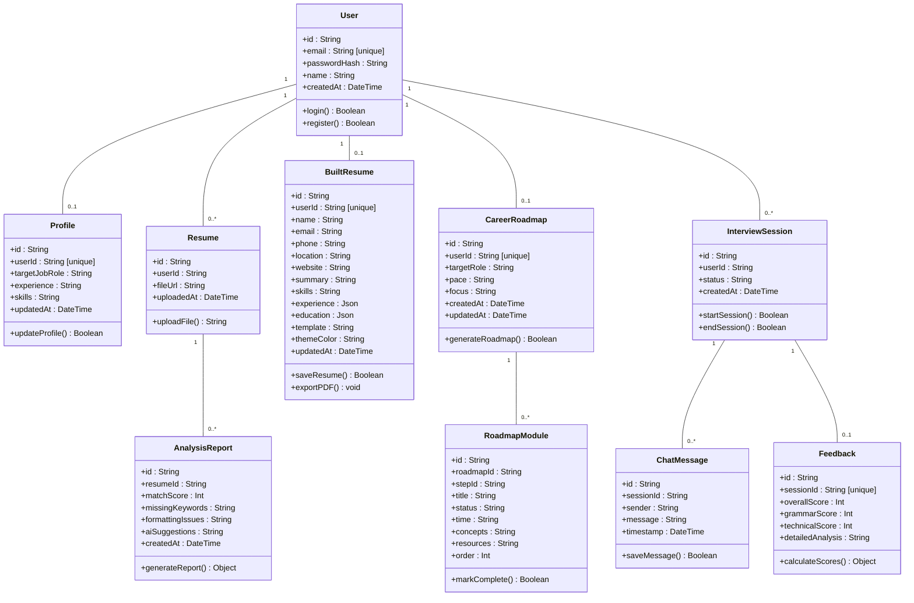
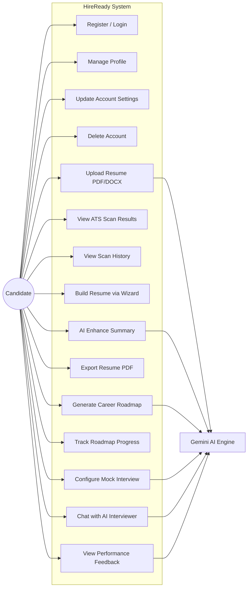

# CHAPTER 6: OVERALL SYSTEM DESIGN AND ARCHITECTURE

This chapter provides a complete overview of the structural design, architectural patterns, and database layouts chosen for the HireReady platform. The system is designed as a unified full-stack application that connects a modern React frontend to a secure server-side AI processing layer and a PostgreSQL relational database. The design decisions presented here are directly informed by the requirements specified in Chapter 5.

---

## 6.1 System Architecture

The HireReady system uses an industry-standard **Three-Tier (Layered) Architecture** pattern, implemented entirely within the Next.js framework. This architectural style enforces a strict separation of concerns, meaning each layer has a specific job and does not interfere with the others. This makes the system easier to maintain, test, and extend (Sommerville, 2016).

### 6.1.1 Presentation Layer (Frontend)

This is what the user sees and interacts with. It is built using **React 19** components styled with **Tailwind CSS v4**. This layer handles:
- Capturing user inputs (resume file uploads, profile details, interview chat messages)
- Rendering visual output (ATS match scores, interview feedback, roadmap progress)
- Providing responsive layouts that adapt to mobile, tablet, and desktop screens

### 6.1.2 Application Logic Layer (Backend)

This is where all the business logic runs. It is managed server-side via **Next.js Server Actions** running within a **Node.js** environment. This layer handles:
- User authentication (registration, login, session management via JWT)
- File processing (PDF and DOCX text extraction using in-memory Buffers)
- AI orchestration (sending prompts to the Google Gemini API and parsing responses)
- Database operations (reading and writing data via Prisma ORM)

By keeping all AI processing on the server side, sensitive API keys and database credentials are completely hidden from the user's browser (Vercel, 2024).

### 6.1.3 Data Layer (Storage)

This layer stores all persistent application data in a **PostgreSQL** relational database, managed through **Prisma ORM**. PostgreSQL was chosen for its ACID compliance (ensuring data consistency), its support for JSON columns (used for storing work experience and education entries), and its robust cascade deletion capabilities (PostgreSQL Global Development Group, 2024).

*Figure 6.1 illustrates the high-level three-tier architecture of the HireReady system.*

---

## 6.2 UML Class Diagram

The UML class diagram below shows all nine domain objects in the HireReady system, their attributes, their methods, and the relationships between them.

### Corrected Class Model



*Figure 6.2: UML Class Diagram showing all 9 domain objects.*

### Relationship Summary

| Relationship | Type | Cascade Delete |
|:--|:--|:--|
| User → Profile | One-to-One | Yes |
| User → Resume | One-to-Many | Yes |
| User → BuiltResume | One-to-One | Yes |
| User → CareerRoadmap | One-to-One | Yes |
| User → InterviewSession | One-to-Many | Yes |
| Resume → AnalysisReport | One-to-Many | Yes |
| CareerRoadmap → RoadmapModule | One-to-Many | Yes |
| InterviewSession → ChatMessage | One-to-Many | Yes |
| InterviewSession → Feedback | One-to-One | Yes |

---

## 6.3 Use Case Diagram

The use case diagram defines what actions the user (Candidate) can perform within the HireReady system and which actions involve the external Gemini AI Engine.

### Corrected Use Case Model



*Figure 6.3: Use Case Diagram with all system features.*

---

## 6.4 Entity Relationship Diagram (ERD)

The ERD shows how the database tables are connected through foreign key relationships. The full ERD contains **9 tables** in total:

```mermaid
erDiagram
    USER ||--|| PROFILE : "has"
    USER ||--o{ RESUME : "uploads"
    USER ||--|| BUILT_RESUME : "owns"
    USER ||--|| CAREER_ROADMAP : "follows"
    USER ||--o{ INTERVIEW_SESSION : "starts"
    RESUME ||--o{ ANALYSIS_REPORT : "generates"
    CAREER_ROADMAP ||--o{ ROADMAP_MODULE : "contains"
    INTERVIEW_SESSION ||--o{ CHAT_MESSAGE : "contains"
    INTERVIEW_SESSION ||--|| FEEDBACK : "evaluates"

    USER {
        string id PK
        string email UK
        string passwordHash
        string name
        datetime createdAt
    }
    PROFILE {
        string id PK
        string userId FK_UK
        string targetJobRole
        string experience
        string skills
        datetime updatedAt
    }
    RESUME {
        string id PK
        string userId FK
        string fileUrl
        datetime uploadedAt
    }
    ANALYSIS_REPORT {
        string id PK
        string resumeId FK
        int matchScore
        string missingKeywords
        string formattingIssues
        string aiSuggestions
        datetime createdAt
    }
    BUILT_RESUME {
        string id PK
        string userId FK_UK
        string name
        string email
        string phone
        string location
        string website
        string summary
        string skills
        json experience
        json education
        string template
        string themeColor
        datetime updatedAt
    }
    CAREER_ROADMAP {
        string id PK
        string userId FK_UK
        string targetRole
        string pace
        string focus
        datetime createdAt
        datetime updatedAt
    }
    ROADMAP_MODULE {
        string id PK
        string roadmapId FK
        string stepId
        string title
        string status
        string time
        string concepts
        string resources
        int order
    }
    INTERVIEW_SESSION {
        string id PK
        string userId FK
        string status
        datetime createdAt
    }
    CHAT_MESSAGE {
        string id PK
        string sessionId FK
        string sender
        string message
        datetime timestamp
    }
    FEEDBACK {
        string id PK
        string sessionId FK_UK
        int overallScore
        int grammarScore
        int technicalScore
        string detailedAnalysis
    }
```

*Figure 6.4: Database Schema Diagram for HireReady with all 9 tables.*

---

## 6.5 Database Schema Implementation (Prisma ORM)

The following Prisma schema defines all nine database models used in the HireReady system. This matches the actual implementation in the codebase.

### 1. User Table (Authentication)

This is the primary identity table. Every other table in the system links back to the User through foreign key relationships with cascade deletion enabled.

```prisma
model User {
  id                String             @id @default(uuid())
  email             String             @unique
  passwordHash      String
  name              String
  createdAt         DateTime           @default(now())
  profile           Profile?
  resumes           Resume[]
  interviewSessions InterviewSession[]
  builtResume       BuiltResume?
  careerRoadmap     CareerRoadmap?
}
```

### 2. Profile Table (User Metadata)

Stores the candidate's career targeting information. This data is used as context input for all AI operations — resume scanning uses the `targetJobRole`, the roadmap uses `skills`, and the interview uses both.

```prisma
model Profile {
  id            String   @id @default(uuid())
  userId        String   @unique
  user          User     @relation(fields: [userId], references: [id], onDelete: Cascade)
  targetJobRole String
  experience    String
  skills        String   // Comma-separated candidate skills
  updatedAt     DateTime @updatedAt
}
```

### 3. Resume and Analysis Report Tables

The `Resume` table stores metadata about uploaded files. The `AnalysisReport` table stores the AI-generated evaluation results. Each resume can have multiple analysis reports if re-scanned.

```prisma
model Resume {
  id              String           @id @default(uuid())
  userId          String
  user            User             @relation(fields: [userId], references: [id], onDelete: Cascade)
  fileUrl         String
  uploadedAt      DateTime         @default(now())
  analysisReports AnalysisReport[]
}

model AnalysisReport {
  id               String   @id @default(uuid())
  resumeId         String
  resume           Resume   @relation(fields: [resumeId], references: [id], onDelete: Cascade)
  matchScore       Int
  missingKeywords  String   // Comma-separated missing keywords
  formattingIssues String   // Comma-separated formatting issues
  aiSuggestions    String
  createdAt        DateTime @default(now())
}
```

### 4. Built Resume Table

Stores the user's resume draft created through the Resume Builder wizard. Uses JSON columns for `experience` and `education` to support multiple entries without needing separate junction tables.

```prisma
model BuiltResume {
  id           String   @id @default(uuid())
  userId       String   @unique
  user         User     @relation(fields: [userId], references: [id], onDelete: Cascade)
  name         String
  email        String
  phone        String
  location     String
  website      String
  summary      String
  skills       String   // Comma-separated
  experience   Json     // Array of experience objects
  education    Json     // Array of education objects
  template     String   @default("classic")
  themeColor   String   @default("slate")
  updatedAt    DateTime @updatedAt
}
```

### 5. Career Roadmap and Module Tables

The `CareerRoadmap` stores the user's learning preferences. The `RoadmapModule` stores each of the 4 sequential learning modules generated by the Gemini API.

```prisma
model CareerRoadmap {
  id         String          @id @default(uuid())
  userId     String          @unique
  user       User            @relation(fields: [userId], references: [id], onDelete: Cascade)
  targetRole String
  pace       String          @default("Standard")
  focus      String          @default("Practical Projects")
  createdAt  DateTime        @default(now())
  updatedAt  DateTime        @updatedAt
  modules    RoadmapModule[]
}

model RoadmapModule {
  id        String        @id @default(uuid())
  roadmapId String
  roadmap   CareerRoadmap @relation(fields: [roadmapId], references: [id], onDelete: Cascade)
  stepId    String
  title     String
  status    String        // "COMPLETED" | "IN_PROGRESS" | "LOCKED"
  time      String
  concepts  String        // Comma-separated
  resources String        // Comma-separated
  order     Int
}
```

### 6. Interview Session, Chat Message, and Feedback Tables

These three tables work together to manage the mock interview flow. `InterviewSession` tracks the session state, `ChatMessage` stores the conversation history, and `Feedback` stores the final AI-generated grades.

```prisma
model InterviewSession {
  id          String        @id @default(uuid())
  userId      String
  user        User          @relation(fields: [userId], references: [id], onDelete: Cascade)
  status      String        // "ONGOING" or "COMPLETED"
  chatHistory ChatMessage[]
  feedback    Feedback?
  createdAt   DateTime      @default(now())
}

model ChatMessage {
  id        String           @id @default(uuid())
  sessionId String
  session   InterviewSession @relation(fields: [sessionId], references: [id], onDelete: Cascade)
  sender    String           // "USER" or "AI"
  message   String
  timestamp DateTime         @default(now())
}

model Feedback {
  id               String           @id @default(uuid())
  sessionId        String           @unique
  session          InterviewSession @relation(fields: [sessionId], references: [id], onDelete: Cascade)
  overallScore     Int
  grammarScore     Int
  technicalScore   Int
  detailedAnalysis String
}
```

---

## 6.6 UI/UX Design System

To create a premium, modern visual identity, HireReady uses a custom **dark-mode glassmorphism** design system built with CSS custom properties mapped into Tailwind CSS v4.

### Design Tokens

| Token | Value | Usage |
|:--|:--|:--|
| Background Canvas | `#080914` | Deep space blue-black page background |
| Brand Purple (Primary) | `#8b5cf6` | Active accents, buttons, key actions |
| Cyan Accent | `#06b6d4` | Interview metrics and chat highlights |
| Emerald Accent | `#10b981` | Success states, progress bars, high scores |
| Rose Accent | `#f43f5e` | Error states, low scores, warnings |
| Amber Accent | `#f59e0b` | Medium scores, caution indicators |
| Primary Text | `#FFFFFF` | Headings and bold content |
| Secondary Text | `#94a3b8` (Slate-400) | Descriptions and supporting text |
| Font Family | Geist Sans | Optimised modern sans-serif typeface |

### Key Visual Components

- **Glass Panels:** Semi-transparent cards with `backdrop-filter: blur(16px)` creating layered depth over radial gradient backgrounds.
- **Glow Buttons:** Interactive buttons with a `skewX(-25deg)` shimmer animation that slides across on hover.
- **Custom Scrollbars:** Thin 6px scrollbars with transparent tracks for a clean, modern feel.

---

## 6.7 AI Integration Architecture

All AI features in HireReady are powered by the **Google Gemini API** using a centralised fallback orchestrator.

### Sequential Model Fallback Chain

To prevent service disruptions from API rate limits or model deprecations, the system implements a sequential fallback chain:

```
gemini-3.5-flash → gemini-3.5-flash-lite → gemini-2.0-flash → gemini-2.0-flash-lite
```

If the primary model returns a 429 (rate limit) or 404 (not found) error, the system automatically retries with the next model in the chain. Non-transient errors (such as invalid prompts) fail immediately without retrying.

### JSON Parsing Pipeline

AI responses are processed through a **three-stage parsing pipeline**:
1. **Stage 1:** Attempt standard `JSON.parse()` on the raw response.
2. **Stage 2:** If that fails, sanitise the response by escaping unescaped newlines and control characters, then retry `JSON.parse()`.
3. **Stage 3:** If both fail, use regex pattern matching to extract individual fields (`matchScore`, `missingKeywords`, etc.) and construct the object manually.

This triple-layer approach ensures that AI features never crash, even when the model returns imperfectly formatted output.

---

## 6.8 Security Architecture

### Authentication Flow

```
Register → bcrypt.hash(password, 10) → Save User + Profile → jwt.sign(userId) → Set HTTP-only Cookie
Login → Find User → bcrypt.compare() → jwt.sign(userId) → Set HTTP-only Cookie
Protected Page → Read Cookie → jwt.verify() → Load User from DB → Allow/Deny Access
```

### Route Protection

Every protected page calls `getCurrentUser()` at the top of its Server Component. If the function returns `null` (no valid session), the user is immediately redirected to `/login`. This ensures that unauthenticated users cannot access the dashboard, resume scanner, interview simulator, or any other protected feature.

---

## 6.9 Project Directory Structure

```
📁 app/
  📁 actions/
    📄 auth.ts           ← Registration, login, profile, session management
    📄 resume.ts         ← File upload, text extraction, AI ATS analysis
    📄 builder.ts        ← AI resume summary enhancement, save/load drafts
    📄 roadmap.ts        ← AI roadmap generation, sequential locking, skill sync
    📄 interview.ts      ← Session creation, chat flow, AI grading engine
    📄 dashboard.ts      ← Dashboard data aggregation queries
  📁 login/
    📄 page.tsx          ← Login form
  📁 register/
    📄 page.tsx          ← Registration form
  📁 dashboard/
    📄 page.tsx          ← Main application hub
  📁 resume/
    📄 page.tsx          ← ATS scanner interface
  📁 resume-builder/
    📄 page.tsx          ← Wizard editor with live preview
  📁 roadmap/
    📄 page.tsx          ← Career roadmap dashboard
  📁 interview/
    📄 page.tsx          ← Interview setup panel
    📁 [id]/
      📄 page.tsx        ← Live chat interface
    📁 feedback/
      📁 [id]/
        📄 page.tsx      ← Performance results dashboard
  📄 page.tsx            ← Landing page
  📄 layout.tsx          ← Root layout
  📄 globals.css         ← Design system tokens and components
📁 lib/
  📄 gemini.ts           ← Centralised Gemini fallback chain
  📄 prisma.ts           ← Prisma client configuration
📁 prisma/
  📄 schema.prisma       ← Database schema (9 models)
  📁 migrations/         ← Database migration history
```

---

## 6.10 Timebox Development Plan

The project is divided into four fixed-duration timeboxes following the DSDM methodology (Stapleton, 2003). Each timebox follows the same structured workflow: use case design → UI design → database design → coding → test plan → test execution.

### Timebox 1: Core Foundation and Authentication
**Timeline:** June 04, 2026 – July 07, 2026 (24 Working Days)
**Features:** User Registration, Login, Profile Setup, Session Management

| Task | Duration | Start Date | End Date |
|:--|:--|:--|:--|
| Use case design | 1 day | June 04 | June 04 |
| UI design | 3 days | June 05 | June 09 |
| Database design | 2 days | June 10 | June 11 |
| Coding | 14 days | June 12 | June 30 |
| Test plan | 2 days | July 01 | July 02 |
| Test logs | 2 days | July 06 | July 07 |

### Timebox 2: AI Resume Intelligence
**Timeline:** July 08, 2026 – August 10, 2026 (24 Working Days)
**Features:** Resume Upload, AI ATS Analyzer, Skill Gap Mapping, Scan History

| Task | Duration | Start Date | End Date |
|:--|:--|:--|:--|
| Use case design | 1 day | July 08 | July 08 |
| UI design | 3 days | July 09 | July 13 |
| Database design | 2 days | July 14 | July 15 |
| Coding | 14 days | July 16 | August 04 |
| Test plan | 2 days | August 05 | August 06 |
| Test logs | 2 days | August 07 | August 10 |

### Timebox 3: AI Resume Builder and Smart Tools
**Timeline:** August 11, 2026 – September 11, 2026 (24 Working Days)
**Features:** AI Resume Builder, Template Customisation, AI Career Roadmap

| Task | Duration | Start Date | End Date |
|:--|:--|:--|:--|
| Use case design | 1 day | August 11 | August 11 |
| UI design | 3 days | August 12 | August 14 |
| Database design | 2 days | August 17 | August 18 |
| Coding | 14 days | August 19 | September 07 |
| Test plan | 2 days | September 08 | September 09 |
| Test logs | 2 days | September 10 | September 11 |

### Timebox 4: Interactive Interview Simulator
**Timeline:** September 14, 2026 – October 16, 2026 (25 Working Days)
**Features:** AI Mock Interview Chatbot, Turn-Based Chat, Performance Feedback

| Task | Duration | Start Date | End Date |
|:--|:--|:--|:--|
| Use case design | 1 day | September 14 | September 14 |
| UI design | 3 days | September 15 | September 17 |
| Database design | 3 days | September 18 | September 21 |
| Coding | 15 days | September 22 | October 12 |
| Test plan | 2 days | October 13 | October 14 |
| Test logs | 2 days | October 15 | October 16 |

---

## 6.11 Chapter Summary

This chapter presented the complete system design for the HireReady platform. The application follows a three-tier layered architecture with React on the frontend, Next.js Server Actions handling backend logic, and PostgreSQL providing persistent storage through Prisma ORM. The database schema comprises 9 interconnected models with cascade deletion rules ensuring data consistency. The UI design system uses a dark-mode glassmorphism aesthetic with custom design tokens. The AI integration layer features a sequential four-model fallback chain with a triple-stage JSON parsing pipeline to ensure reliability. The security architecture protects user data through bcrypt password hashing, JWT session tokens in HTTP-only cookies, and server-side API key isolation. Development is planned across four DSDM timeboxes spanning from June to October 2026.

---

### References (Chapter 6)

- PostgreSQL Global Development Group (2024) *PostgreSQL 16 Documentation*. Available at: https://www.postgresql.org/docs/16/ (Accessed: 15 August 2026).
- Prisma (2024) *Prisma Documentation: Overview*. Available at: https://www.prisma.io/docs (Accessed: 15 August 2026).
- Sommerville, I. (2016) *Software Engineering*. 10th edn. Harlow: Pearson Education.
- Stapleton, J. (2003) *DSDM: Business Focused Development*. 2nd edn. Harlow: Addison-Wesley.
- Vercel (2024) *Next.js Documentation*. Available at: https://nextjs.org/docs (Accessed: 15 August 2026).
