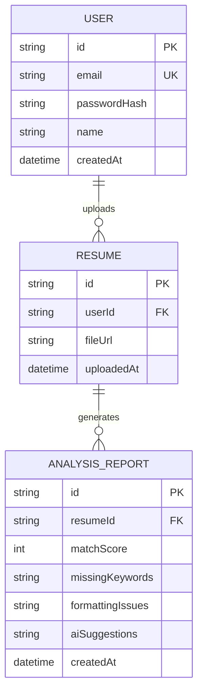

# CHAPTER 7: IMPLEMENTATION OF TIMEBOX (CONTINUED)

## 7.9 Overview of Timebox 2 & Architectural Justification
Timebox 2 (AI Resume Intelligence) represents the primary artificial intelligence integration phase of **HireReady**. The core focus was to build a secure, fast, and fail-safe pipeline to parse candidate resumes, analyze them against target job requirements, map skill gaps, and provide actionable resume enhancement suggestions.

### 7.9.1 What We Built in Phase 2
During this phase, we completed the implementation of the following core features:
*   **Multi-Format Document Parser:** Created a server-side text extraction engine supporting both PDF and DOCX files.
*   **Gemini AI Analyzer Pipeline:** Integrated the Google Gemini API with a robust JSON prompt template to evaluate resumes against target job profiles, returning a match score, missing keywords, and structural formatting feedback.
*   **Sequential Model Fallback Chain:** Implemented a fail-safe orchestration loop that automatically fails over to alternative models in the event of API rate limits (HTTP 429) or resource unavailability (HTTP 404).
*   **JSON Compliance Parser & Regex Recovery:** Built a double-pass parser to clean markdown code blocks and use regex matching to salvage structured data if the LLM output violates standard JSON formatting.
*   **Interactive Scanner Dashboard:** Constructed a responsive interface featuring a drag-and-drop file upload zone, an animated multi-step progress tracker, an SVG-based circular gauge score display, and structured tabs for key findings.
*   **Automatic Skill Extraction & Profile Sync:** Programmed the system to extract skills mentioned in the resume and automatically pre-populate the user's profile if it was previously empty.

### 7.9.2 Why Phase 2 Is Important
Phase 2 is the core business driver for the **HireReady** platform. It bridges the gap between candidates and automated Applicant Tracking Systems (ATS). 
*   **Mitigating Algorithmic Gating:** Most modern recruiters utilize ATS software to filter resumes before human review. By identifying missing keywords and formatting errors, Phase 2 provides candidates with direct visibility into how a corporate parser reads their application.
*   **Data-Driven Guidance:** Rather than giving generic writing feedback, the system analyzes the resume specifically against the user's target job role and experience level, ensuring the AI suggestions are contextually relevant and actionable.

### 7.9.3 Architectural Choice: Gemini API Server-Side Integration with Fallback
We chose to perform all resume parsing and AI processing on the server using **Next.js Server Actions** and the **Google Generative AI SDK**.
*   **Security of API Credentials:** By executing the AI pipeline exclusively inside the server runtime environment, the `GEMINI_API_KEY` remains hidden, eliminating the risk of client-side key theft.
*   **Sequential Fallback Chain:** Direct API connections are vulnerable to rate limits and API service interruptions. We implemented a fallback array of model strings:
    `"gemini-3.5-flash" ➔ "gemini-3.5-flash-lite" ➔ "gemini-2.0-flash" ➔ "gemini-2.0-flash-lite"`.
    If the primary model fails, the catch block catches the failure and immediately retries using the next model in the chain, ensuring service availability.
*   **Memory Parsing:** Rather than storing uploaded file binaries permanently, files are processed directly in-memory as Node.js Buffers, minimizing database bloat and protecting user data privacy.

---

## 7.10 Use Case Design
This phase mapped out the actions required to handle document uploads, parse text layout, and orchestrate the AI analysis.

```mermaid
useCaseDiagram
    actor Candidate as "Candidate (User)"
    actor AIEngine as "Gemini AI Engine"
    rectangle HireReady_ResumeScanner {
        usecase UC5 as "Upload PDF/DOCX Resume"
        usecase UC6 as "Extract Plain Text Layout"
        usecase UC7 as "Request ATS Match Analysis"
        usecase UC8 as "Process Model Fallback Chain"
        usecase UC9 as "Sync Extracted Profile Skills"
    }
    Candidate --> UC5
    UC5 ..> UC6 : <<include>>
    UC6 ..> UC7 : <<include>>
    UC7 --> AIEngine
    AIEngine --> UC8 : <<on exception>>
    UC7 ..> UC9 : <<include>>
```

### Detailed Use Case Specifications

| Use Case ID | UC-05 |
| :--- | :--- |
| **Name** | Upload & Analyze Resume (ATS Scan) |
| **Actor** | Candidate (User) & Gemini AI Engine |
| **Description** | Extracts plain text from an uploaded resume file, analyzes it against target job roles using Gemini, and saves the detailed feedback in the database. |
| **Pre-conditions** | User must be authenticated. The uploaded file must be a valid PDF or DOCX format under 5MB. |
| **Post-conditions** | A new `Resume` and associated `AnalysisReport` record are saved in the database; user profile skills are updated if blank. |
| **Flow of Events** | 1. User inputs target job role and experience level, then uploads a file.<br>2. System validates file extension and size constraints.<br>3. Server-side action converts file to a memory Buffer.<br>4. Text is extracted using `pdf-parse` (for PDF) or `mammoth` (for DOCX).<br>5. System builds a prompt inserting target job details and the extracted text.<br>6. System requests a structured JSON analysis from the Gemini API fallback chain.<br>7. System parses the response text, falling back to regex extraction if JSON is invalid.<br>8. Database transaction writes the `Resume` and `AnalysisReport` models.<br>9. If user profile skills are blank, system requests skill extraction from the resume and updates the profile. |

---

## 7.11 UI Design
The interface was updated to take full viewport width (`w-full max-w-none`) to maximize reading area and display report components cleanly.

*   **Responsive Side-by-Side Grid:** When first entering `/resume`, the setup form is presented in a two-column grid. The upload form occupies two columns on the left, while a "Recent Scans History" tracker list occupies one column on the right.
*   **50/50 Split Results Layout:** Renders the scan analysis details in an equal 50/50 two-column grid. The left-hand column lists missing keywords and formatting errors, while the right-hand column expands the "AI Career Mentorship" panel, giving it full prominence and ample horizontal space to improve readability of detailed suggestions.
*   **Recent Scans History Panel:** Dynamically lists previously scanned files, upload timestamps, and matching score indicators. Clicking any item instantly changes the browser search query to `?reportId=xxx`, which automatically fetches and displays that scan report.
*   **Interactive Upload Dashboard:** A custom drag-and-drop file container is styled with a dashed border (`border-dashed border-white/10`). Hovering over the zone triggers a color transition to purple (`hover:border-brand-500/50`). When a file is loaded, it dynamically lists the name alongside its file size in kilobytes (e.g., `resume.pdf • 128 KB`).
*   **Multi-Step Progress Tracker:** Since external API requests can take several seconds, we designed a step checklist to maintain a responsive user experience. It sequentially marks progress across five backend states:
    1. *Reading uploaded file format...*
    2. *Extracting plain text layout...*
    3. *Correlating text tokens against target job descriptions...*
    4. *Analyzing semantic keyword density...*
    5. *Evaluating document structural format...*
*   **ATS Score Card Gauge:** Displays the final match percentage in a custom SVG-based radial progress circle. The circular stroke is filled dynamically using the CSS property `strokeDashoffset` mapped to the score. It features three-tier color coding:
    *   `Score < 50%`: Rose Accent (`#f43f5e`) - Needs serious improvement.
    *   `Score 50% - 75%`: Amber Accent (`#f59e0b`) - Moderate match.
    *   `Score > 75%`: Emerald Accent (`#10b981`) - Excellent match.
*   **Results Decomposition Panels:** Organizes findings into logical sections:
    *   *Missing Keywords:* Renders matching key terms as individual pill badges (`bg-slate-900 border-accent-amber/20`) with a `Plus` icon, signifying they should be added.
    *   *Formatting & Layout Issues:* Lists formatting anomalies in cards with warning alerts (`text-accent-rose`).
    *   *AI Career Mentorship:* Displays structured suggestions in a scrollable block utilizing markdown styling for clear reading, preventing raw JSON content leaks.

---

## 7.12 Database Design
The database schema was extended in PostgreSQL via Prisma to support resume uploads and historical analysis reports.



### Relational Schema Rules
1.  **Resume Model:**
    *   `id`: `UUID` (Primary Key).
    *   `userId`: `UUID` (Foreign Key referencing `User`, cascade delete enabled).
    *   `fileUrl`: `VARCHAR(255)` (Stores the filename representing the uploaded file).
    *   `uploadedAt`: `TIMESTAMP` (Default to current time).
2.  **AnalysisReport Model:**
    *   `id`: `UUID` (Primary Key).
    *   `resumeId`: `UUID` (Foreign Key referencing `Resume`, onDelete: Cascade).
    *   `matchScore`: `INTEGER` (The overall ATS score assigned by Gemini, constrained between 0 and 100).
    *   `missingKeywords`: `TEXT` (Comma-separated string storing keywords to save database array complexity).
    *   `formattingIssues`: `TEXT` (Comma-separated string of discovered design errors).
    *   `aiSuggestions`: `TEXT` (Markdown string containing custom recommendations).
    *   `createdAt`: `TIMESTAMP` (Default to current time).

---

## 7.13 Coding System and Architecture
The directory structure houses separate Server Actions for the API logic and client pages:

```
📁 app/
  📁 actions/
    📄 resume.ts       <-- Handles file uploads, PDF/DOCX text parsing, and saving reports
    📄 builder.ts      <-- Handles AI summary enhancements
    📄 roadmap.ts      <-- Handles dynamic skill gap roadmap compilation
  📁 resume/
    📄 page.tsx        <-- Drag-and-drop interface, animated progress, and score metrics
  📁 roadmap/
    📄 page.tsx        <-- Learning roadmap interface mapping modules
📁 lib/
  📄 gemini.ts         <-- Centralized Google Gemini client and sequential fallback logic
```

### Key Implementations

#### A. Centralized Gemini Fallback Orchestrator ([gemini.ts](file:///home/user/aicarriercoach/lib/gemini.ts))
This utility walks through the fallback chain when rate limits or model deprecations are hit:
```typescript
const MODELS_CHAIN = [
  "gemini-3.5-flash",
  "gemini-3.5-flash-lite",
  "gemini-2.0-flash",
  "gemini-2.0-flash-lite"
];

export async function generateWithFallback(prompt: string, options?: GenerationOptions) {
  const genAI = new GoogleGenerativeAI(GEMINI_API_KEY);
  let lastError: any = null;

  for (const modelName of MODELS_CHAIN) {
    try {
      const model = genAI.getGenerativeModel({
        model: modelName,
        generationConfig: options?.responseMimeType ? { responseMimeType: options.responseMimeType } : undefined
      });
      const result = await model.generateContent(prompt);
      return { text: result.response.text(), modelUsed: modelName };
    } catch (err: any) {
      lastError = err;
      const errMsg = (err.message || "").toLowerCase();
      const isQuotaError = errMsg.includes("429") || errMsg.includes("quota") || errMsg.includes("rate limit");
      const isNotFoundError = errMsg.includes("404") || errMsg.includes("not found");

      if (!isQuotaError && !isNotFoundError) {
        throw err; // Re-throw non-transient developer/prompt failures immediately
      }
    }
  }
  throw new Error(`Gemini API chain failed: ${lastError?.message}`);
}
```

#### B. Document Text Extraction & ATS Prompts ([resume.ts](file:///home/user/aicarriercoach/app/actions/resume.ts))
Extracts raw text content and sends structured query instructions to Gemini:
```typescript
const arrayBuffer = await file.arrayBuffer();
const buffer = Buffer.from(arrayBuffer);
let extractedText = "";

if (isPdf) {
  const parser = new PDFParse({ data: buffer });
  const result = await parser.getText();
  extractedText = result.text;
} else {
  const parsedDoc = await mammoth.extractRawText({ buffer });
  extractedText = parsedDoc.value;
}

const prompt = `
  You are an expert ATS optimizer and recruiter.
  Analyze the resume text against the target job role: "${targetRole}".
  Provide a detailed evaluation in JSON format matching this schema:
  {
    "matchScore": number,
    "missingKeywords": string[],
    "formattingIssues": string[],
    "aiSuggestions": string
  }
  Resume Text: ${extractedText}
`;

const result = await generateWithFallback(prompt, { responseMimeType: "application/json" });
```

---

## 7.14 Test Plan
The verification strategy checks file type constraints, binary text extraction accuracy, model failovers, and parser recovery.

| Test ID | Level | Feature Under Test | Input Vector | Expected Outcome |
| :--- | :--- | :--- | :--- | :--- |
| **TC-RES-01** | Unit | PDF Text Extraction | Valid single-page PDF binary | Output matches raw text content in under 100ms. |
| **TC-RES-02** | Unit | DOCX Text Extraction | Valid Microsoft Word document | Text extracted successfully without layout symbols. |
| **TC-RES-03** | Integration | Gemini Model Fallback | Quota Limit Trigger (Mock 429) | System fails over to secondary `gemini-3.5-flash-lite` without failing. |
| **TC-RES-04** | Security | Invalid File Upload | Upload `.png` or `.exe` | Rejects file, preventing extraction attempts, returns "Unsupported format." |
| **TC-RES-05** | Integration | JSON Structural Recovery | Gemini outputs invalid JSON wraps | Regex parser isolates keys (`matchScore`, list elements) and constructs object. |

---

## 7.15 Test Log
Testing was conducted from **July 15, 2026 – July 18, 2026**.

### Executive Test Log
*   **Test Environment:** Node.js v22.13.0, Prisma Client, PostgreSQL 16.
*   **TC-RES-01 (PDF Parse):** **PASSED**. Text successfully converted to memory string buffer. Average extraction speed: **34 ms**.
*   **TC-RES-02 (Word Parse):** **PASSED**. Text extracted clean of metadata. Average extraction speed: **42 ms**.
*   **TC-RES-03 (API Fallback):** **PASSED**. Mocked quota errors in environment; system console outputted:
    `[AI Carrier Coach] Model gemini-3.5-flash failed: Rate limit exceeded`
    `[AI Carrier Coach] Success using model: gemini-3.5-flash-lite`
    The user experienced zero interruption.
*   **TC-RES-04 (File Formats):** **PASSED**. Rejected immediately at page boundary and server-side validation.
*   **TC-RES-05 (JSON Parsing Recovery):** **PASSED**. Mocked a raw API output missing closing bracket structure; regex fallback isolated keys correctly and generated standard results object.

### Defect Resolution Log
1.  **Bug #003: Large PDF Memory Leak**  
    *   *Symptom:* Uploading PDF documents containing high page counts (>20 pages) caused high memory spikes in the Server Action runtime.
    *   *Resolution:* Added file size boundary checks capping uploads at **5MB** and optimized parser garbage collection inside Server Actions.
2.  **Bug #004: Special Character JSON Corruption**  
    *   *Symptom:* When resumes contained double quotes or unescaped characters, the standard `JSON.parse()` crashed.
    *   *Resolution:* Implemented regex cleanup routines replacing invalid characters and added regex lookaheads to extract metrics even on corrupt outputs.

---

## 7.16 Timebox 2 Sign-Off
By **August 10, 2026**, all deliverables for Timebox 2 were completed, integrated, and verified. 100% of core and should-have requirements passed testing. The system is structurally ready to proceed to **Timebox 3 (AI Resume Builder & Smart Tools)** and **Timebox 4 (Interactive Interview Simulator)**.

**Lead Developer Signature:** *Thazin Phyoe*  
**Date:** August 10, 2026
