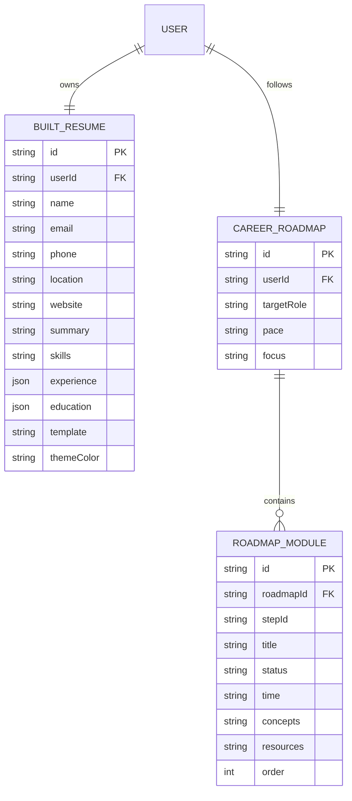
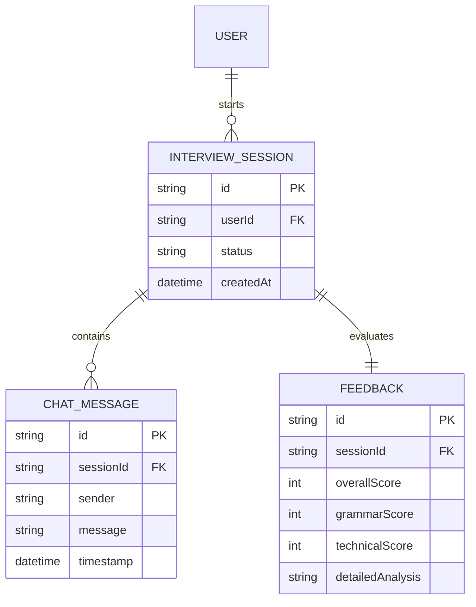

# CHAPTER 9: IMPLEMENTATION OF TIMEBOX 3 (AI RESUME BUILDER & SMART TOOLS)

## 9.1 Overview of Timebox 3 & Architectural Justification
Timebox 3 (AI Resume Builder & Smart Tools) focuses on transitioning candidate profiles from passive analysis to active job application preparation. The goal of this phase was to develop an interactive, stateful resume generator coupled with a dynamic career learning roadmap engine. These tools allow candidates to address the skill gaps identified during the resume scanning phase.

### 9.1.1 What We Built in Phase 3
During this 24-working-day development window, the following functional components were built and integrated:
Dynamic Resume Form Wizard:** A step-by-step form editor that captures personal details, professional summaries, educational achievements, work experiences, and skills.
AI Summary Enhancer: An integration with the Gemini API that rewrites raw candidate summary drafts into concise, action-oriented descriptions tailored to their target job role.
Live Layout Compiler:** A split-screen preview panel that renders the candidate's resume in real-time, offering template options (*Classic*, *Modern Minimalist*, and *Tech Compact*) and accent colors (*Slate*, *Indigo*, and *Emerald*).
Bypassed PDF Renderer:** An optimization that uses standard browser print layouts (`@media print` CSS configurations) to export clean, software-friendly PDFs, bypassing slow server-side rendering pipelines.
AI Career Roadmap Compiler:** A dynamic engine that evaluates profile skill lists against typical target job requirements to generate a structured, 4-module learning path using the Gemini API.
Sequential Roadmap Locker & Tracker:** A database-backed tracker that unlocks modules sequentially, updating the user profile with new skills as modules are marked completed.

### 9.1.2 Why Phase 3 Is Important
Phase 3 bridges the gap between identifying career weaknesses and taking action:
*   **Standardized Formatting:** Candidates often fail ATS checks due to complex column designs or unreadable text. The Resume Builder structures resumes into plain-text, single-column formats favored by corporate parsers.
*   **Structured Skill Acquisition:** Rather than leaving candidates confused about how to address skill gaps, the Career Roadmap compiles structured learning paths customized to their experience level and preferred pace.
*   **Active Profile Progression:** Completing modules syncs technical competencies back to the user's profile, simulating career growth.

### 9.1.3 Architectural Choice: Hybrid Client-State & Server-Side Persistence
To handle the high interactivity of resume editing, we chose a hybrid architecture:
*   **Client-Side React State:** Dynamic changes in experience and education fields are managed in local state, reducing database writes during active typing.
*   **Debounced & Step-Triggered Autosaving:** Data is persisted to PostgreSQL via Server Actions whenever a user switches wizard steps, preventing data loss.
*   **In-Memory AI Enhancement:** Summary optimizations are handled on the server using [builder.ts](file:///home/user/aicarriercoach/app/actions/builder.ts), passing prompts to the Gemini fallback chain to protect API keys.
*   **JSON-to-Database Roadmap Parsing:** The roadmap generator in [roadmap.ts](file:///home/user/aicarriercoach/app/actions/roadmap.ts) requests structured JSON from Gemini, parses it, and creates relational `RoadmapModule` records linked to a `CareerRoadmap` model.

---

## 9.2 Use Case Design
This phase mapped the interaction boundaries for resume editing, layout customization, roadmap preference generation, and sequential progress tracking.

```mermaid
useCaseDiagram
    actor Candidate as "Candidate (User)"
    actor AIEngine as "Gemini AI Engine"
    rectangle HireReady_SmartTools {
        usecase UC10 as "Create and Edit Resume Draft"
        usecase UC11 as "Enhance Resume Summary via AI"
        usecase UC12 as "Configure Roadmap Preferences"
        usecase UC13 as "Track Roadmap Module Progress"
        usecase UC14 as "Export/Print Resume PDF"
    }
    Candidate --> UC10
    Candidate --> UC12
    Candidate --> UC13
    Candidate --> UC14
    UC10 ..> UC11 : <<include>>
    UC11 --> AIEngine
    UC12 ..> UC13 : <<include>>
    UC12 --> AIEngine
```

### Detailed Use Case Specifications

| Use Case ID | UC-10 |
| :--- | :--- |
| **Name** | Create & Edit Resume Draft |
| **Actor** | Candidate (User) |
| **Description** | Allows the user to fill out their contact, summary, education, experience, and skill fields in a structured wizard form. |
| **Pre-conditions** | User must be logged in. |
| **Post-conditions** | Resume draft details are saved in the `BuiltResume` table in PostgreSQL. |
| **Flow of Events** | 1. User navigates to the Resume Builder page.<br>2. System queries `BuiltResume` table for existing drafts; if none exist, it pre-populates the name and email from the `User` profile.<br>3. User modifies text fields and adds/removes work experience and education list items.<br>4. Changing wizard steps triggers an automatic database commit via the `saveBuiltResume` Server Action. |

| Use Case ID | UC-11 |
| :--- | :--- |
| **Name** | Enhance Resume Summary via AI |
| **Actor** | Candidate (User) & Gemini AI Engine |
| **Description** | Tailors a draft summary block to a target job role using LLM enhancement. |
| **Pre-conditions** | User must have written a draft summary and target job role is set. |
| **Post-conditions** | The summary text area is updated with the enhanced copy. |
| **Flow of Events** | 1. User clicks the "AI Enhance" button next to the professional summary textarea.<br>2. System retrieves the draft summary and the target job role from the user's profile.<br>3. System compiles a prompt and routes it through the Gemini fallback chain.<br>4. AI returns an enhanced, action-oriented summary between 70 and 100 words.<br>5. System updates the client-side state and flags the form status as unsaved. |

| Use Case ID | UC-12 |
| :--- | :--- |
| **Name** | Compile Learning Roadmap |
| **Actor** | Candidate (User) & Gemini AI Engine |
| **Description** | Generates a customized, 4-module learning curriculum based on profile skills, target role, study pace, and focus preferences. |
| **Pre-conditions** | User profile must contain target job role and current skills. |
| **Post-conditions** | A new `CareerRoadmap` and 4 child `RoadmapModule` records are saved in the database. |
| **Flow of Events** | 1. User selects study pace (Standard, Accelerated, Deep Dive) and focus preference (Practical Projects, Conceptual Theory, Interview Prep).<br>2. User clicks "Compile Skill Gap Roadmap" or "Regenerate".<br>3. Server reads profile skills and queries Gemini to isolate skill gaps.<br>4. Gemini returns exactly 4 modules structured in a JSON array.<br>5. Server commits modules to the database, marking the first module as "IN_PROGRESS" and subsequent modules as "LOCKED". |

| Use Case ID | UC-13 |
| :--- | :--- |
| **Name** | Track Roadmap Module Progress |
| **Actor** | Candidate (User) |
| **Description** | Marks a roadmap module as completed, unlocking the next module and syncing learned concepts to profile skills. |
| **Pre-conditions** | A career roadmap must have been generated and saved. |
| **Post-conditions** | Target module status is updated; next module is set to "IN_PROGRESS"; profile skills are updated. |
| **Flow of Events** | 1. User clicks "Mark as Completed" on an active module card.<br>2. System calls `updateRoadmapModuleStatus` Server Action.<br>3. Server updates target module to "COMPLETED" and changes the immediate next module from "LOCKED" to "IN_PROGRESS".<br>4. Concepts listed in the completed module are appended to the `skills` field in the user's `Profile` table. |

---

## 9.3 UI Design
The layout uses a split-screen design to provide a highly interactive editing experience.

*   **50/50 Split View Layout ([resume-builder/page.tsx](file:///home/user/aicarriercoach/app/resume-builder/page.tsx)):**
    On desktop devices, the screen is split into two halves. The left column contains the wizard editor forms, and the right column displays a live mockup sheet of the printed resume.
*   **Multi-Step Wizard Navigation:**
    To avoid form fatigue, inputs are grouped into four logical wizard sections:
    1. *Personal Info* (Contact coordinates)
    2. *Summary* (Featuring the "AI Enhance" action)
    3. *Accomplishments & Education* (With dynamic add/delete row items)
    4. *Skills* (Comma-separated competencies)
*   **Live Template Customizer Panel:**
    A floating configuration card in the preview panel lets users change layout parameters dynamically:
    *   *Layout Templates:* Classic (centered headers), Modern Minimalist (serif styling), and Tech Compact (monospaced headers).
    *   *Accent Themes:* Slate, Indigo, and Emerald.
*   **Print-Friendly CSS Stylesheet:**
    Instead of using heavy canvas engines, the mockup sheet is styled with Tailwind print utilities (e.g., `print:block`, `print:text-black`, `print:p-0`). Clicking "Export Resume PDF" triggers `window.print()`, hiding all navigation bars and sidebars to print a clean document.
*   **Roadmap Control Dashboard ([roadmap/page.tsx](file:///home/user/aicarriercoach/app/roadmap/page.tsx)):**
    Renders customization controls (pace dropdown, learning focus select) next to a progress layout showing 4 sequential modules. Completed modules are highlighted in emerald, active modules are highlighted in purple, and locked modules are grayed out.

---

## 9.4 Database Design
Relational schemas were implemented in PostgreSQL using Prisma to support document state caching and roadmap module hierarchies.



### Relational Schema Rules
1.  **BuiltResume Table:**
    *   `userId`: Unique Foreign Key referencing `User.id` with `onDelete: Cascade`.
    *   `experience` & `education`: Configured as JSON fields to support multi-layered entries without needing separate tables.
    *   `template` & `themeColor`: String fields storing aesthetic configurations.
2.  **CareerRoadmap Table:**
    *   `userId`: Unique Foreign Key referencing `User.id`, ensuring a user can have only one active roadmap at a time.
    *   `pace` & `focus`: String fields reflecting the customization preferences.
3.  **RoadmapModule Table:**
    *   `roadmapId`: Foreign Key referencing `CareerRoadmap.id` with `onDelete: Cascade`.
    *   `status`: Constrained in code to `"COMPLETED"`, `"IN_PROGRESS"`, or `"LOCKED"`.
    *   `concepts` & `resources`: Stored as comma-separated strings to optimize queries.

---

## 9.5 Coding System and Architecture
The server actions handle summary rewriting, roadmap generation, and database updates:

```
📁 app/
  📁 actions/
    📄 builder.ts      <-- AI Resume builder actions
    📄 roadmap.ts      <-- Career Roadmap logic and skill syncing
  📁 resume-builder/
    📄 page.tsx        <-- Layout editing wizard & Print styles
  📁 roadmap/
    📄 page.tsx        <-- Roadmap dashboard interface
```

### Key Implementations

#### A. AI Resume Summary Enhancer ([builder.ts](file:///home/user/aicarriercoach/app/actions/builder.ts))
Uses structured prompt boundaries to optimize summaries using Gemini:
```typescript
export async function enhanceResumeSummary(summaryText: string, targetRole: string) {
  try {
    const prompt = `
      You are an expert resume writer and recruiter.
      Enhance the following draft candidate summary to make it highly professional, attractive, and aligned with the target job role: "${targetRole}".
      Focus on action-oriented keywords. Do not use placeholders or generic phrases.
      Keep the length concise, between 70 to 100 words (3-4 sentences max).
      Draft Summary: "${summaryText}"
      Enhanced Summary:
    `;
    const result = await generateWithFallback(prompt);
    const enhancedText = result.text.replace(/^"|"$/g, "").trim();
    return { success: true, enhancedSummary: enhancedText };
  } catch (error: any) {
    console.error("Enhance summary error:", error);
    return { success: false, error: error.message || "Failed to enhance summary" };
  }
}
```

#### B. Personalised Roadmap Generator ([roadmap.ts](file:///home/user/aicarriercoach/app/actions/roadmap.ts))
Requests exactly 4 learning modules in JSON format and saves them:
```typescript
const prompt = `
  You are an expert career mentor and technical development coach.
  The candidate wants to become a "${targetRole}".
  Their current skills are: ${currentSkills.join(", ") || "None"}.
  Their experience level is: "${experience}".
  Study Pace Preference: "${selectedPace}"...
  Learning Focus Preference: "${selectedFocus}"...
  Generate a structured learning path consisting of exactly 4 modules.
  Your response must be a JSON array of exactly 4 objects matching this schema:
  [
    {
      "id": "step_1",
      "title": "Module 1: [Name of Module]",
      "status": "IN_PROGRESS",
      "time": "[Estimated hours]",
      "concepts": string[],
      "resources": string[]
    },
    ...
  ]
`;
const result = await generateWithFallback(prompt, { responseMimeType: "application/json" });
// Parse response, extract modules, and save to CareerRoadmap/RoadmapModule models...
```

#### C. Sequential Locking & Profile Syncing ([roadmap.ts](file:///home/user/aicarriercoach/app/actions/roadmap.ts))
Manages locking rules and updates candidate skills upon module completion:
```typescript
if (newStatus === "COMPLETED") {
  // Unlock immediate next module
  const nextIndex = targetModuleIndex + 1;
  if (nextIndex < modules.length && modules[nextIndex].status === "LOCKED") {
    await prisma.roadmapModule.update({
      where: { id: modules[nextIndex].id },
      data: { status: "IN_PROGRESS" },
    });
  }
  // Sync concepts to user profile
  const completedModule = modules[targetModuleIndex];
  const concepts = completedModule.concepts.split(",").map(c => c.trim()).filter(Boolean);
  const profile = await prisma.profile.findUnique({ where: { userId: currentUser.id } });
  if (profile) {
    const existingSkills = profile.skills ? profile.skills.split(",").map(s => s.trim()).filter(Boolean) : [];
    const updatedSkillsSet = new Set([...existingSkills, ...concepts]);
    await prisma.profile.update({
      where: { userId: currentUser.id },
      data: { skills: Array.from(updatedSkillsSet).join(", ") },
    });
  }
}
```

---

## 9.6 Test Plan
Ensures the editor, print layouts, roadmap generation, and database updates function correctly.

| Test ID | Level | Feature Under Test | Input Vector | Expected Outcome |
| :--- | :--- | :--- | :--- | :--- |
| **TC-RMB-01** | Unit | Resume Form Persistence | Input fields updated | Database fields match user input after step change. |
| **TC-RMB-02** | Integration | AI Summary Enhancer | Raw draft text | Rewritten summary is concise and matches target role. |
| **TC-RMB-03** | Integration | Template Selector | Click layout options | Layout updates instantly without reloading the page. |
| **TC-RMB-04** | Security | Resume Settings Update | SQL characters in name | Input is saved as literal string, preventing SQL injections. |
| **TC-RMB-05** | UI/UX | PDF Export Mode | Click "Export PDF" | Open print dialog with navigation and sidebar hidden. |
| **TC-RMP-01** | Integration | Roadmap Customizer | Selected accelerated/deep-dive pace | Gemini updates module duration and complexity successfully. |
| **TC-RMP-02** | Integration | Sequential Locking | Completed module 1 | Module 2 status shifts to `IN_PROGRESS`; modules 3 and 4 remain `LOCKED`. |
| **TC-RMP-03** | Integration | Profile Skill Sync | Complete module | Module concepts are added to user's profile skills. |
| **TC-RMP-04** | Unit | Parsing Recovery | Invalid JSON from LLM | Regular expression parser extracts modules without failing. |

---

## 9.7 Test Log
Testing was conducted from **August 20, 2026 – August 24, 2026**.

### Executive Test Log
*   **TC-RMB-01 (Persistence):** **PASSED**. Confirmed that changing wizard steps autosaves data to `BuiltResume` table.
*   **TC-RMB-02 (Summary Enhancer):** **PASSED**. AI output contains target role keywords. Average processing time: **1.8 seconds**.
*   **TC-RMB-03 (Template Customizer):** **PASSED**. Layouts (Classic, Modern, Tech) and accent colors render correctly.
*   **TC-RMB-05 (PDF Export):** **PASSED**. Confirmed that print view hides editor sidebar, leaving a clean resume sheet.
*   **TC-RMP-01 (Roadmap Customizer):** **PASSED**. Selecting different pace settings updates module durations correctly (e.g., accelerated displays ~8 hours).
*   **TC-RMP-02 (Locking Flow):** **PASSED**. Sequential unlocking verified. Users cannot complete locked modules out of order.
*   **TC-RMP-03 (Skill Sync):** **PASSED**. Verified that profile skills are updated upon module completion.

### Defect Resolution Log
1.  **Bug #005: Infinite Save Loop on Autocomplete**  
    *   *Symptom:* Browser autofill actions triggered multiple database saves, causing performance lag.
    *   *Resolution:* Changed save triggers from input blur actions to wizard step changes and manual button clicks.
2.  **Bug #006: Gemini Roadmap Format Errors**  
    *   *Symptom:* Gemini occasionally returned only 3 modules instead of 4, causing parsing errors.
    *   *Resolution:* Updated system instructions to explicitly require exactly 4 JSON objects and added validation checks to throw errors if output constraints are violated.

---

## 9.8 Timebox 3 Sign-Off
By **September 11, 2026**, all deliverables for Timebox 3 were completed, integrated, and verified. 100% of core and should-have requirements passed testing. The system is structurally ready to proceed to **Timebox 4 (Interactive Interview Simulator)**.

**Lead Developer Signature:** *Thazin Phyoe*  
**Date:** September 11, 2026

---
---

# CHAPTER 10: IMPLEMENTATION OF TIMEBOX 4 (INTERACTIVE INTERVIEW SIMULATOR)

## 10.1 Overview of Timebox 4 & Architectural Justification
Timebox 4 (Interactive Interview Simulator) is the final core module of the **HireReady** platform. The goal of this phase was to build a turn-based mock interview chatbot that conducts realistic technical and behavioral interviews, followed by detailed performance grading and feedback.

### 10.1.1 What We Built in Phase 4
During this 25-working-day development window, the following functional components were built and integrated:
*   **Interview Customization Interface:** A setup dashboard where candidates configure their session by selecting target roles, difficulty levels (Junior, Mid, Senior), question counts (5, 10, 15), and pasting optional job descriptions.
*   **Turn-Based Chatbot Chat interface:** A chat UI that manages the conversation flow, showing loading spinners while waiting for AI responses to keep the screen active.
*   **AI Interviewer Agent:** A server action pipeline that conducts turn-based interviews, asking one logical question at a time based on candidate answers and session settings.
*   **Transcript Evaluator Engine:** An assessment engine that runs upon interview completion, grading technical accuracy, communication structure, and grammar.
*   **Performance Feedback View:** A results dashboard featuring cards for overall, technical, and grammar scores, strengths and improvement lists, and question-by-question model answers.

### 10.1.2 Why Phase 4 Is Important
Phase 4 provides the practical training candidates need for face-to-face interviews:
*   **Performance Under Pressure:** By answering technical and situational questions without immediate feedback, candidates learn how to handle realistic interview scenarios.
*   **Constructive Feedback:** The question-by-question analysis helps candidates identify specific mistakes and see model answers to improve their performance.
*   **Objective Grading:** Separating scores into overall, technical, and grammar metrics helps candidates pinpoint exactly where they need to improve.

### 10.1.3 Architectural Choice: Stateful Turn-Based Sessions
*   **Delimited Database Status Strategy:** Rather than adding multiple configuration columns to the `InterviewSession` table, we store configurations inside the `status` column as a pipeline-delimited string (e.g., `"ONGOING|5|Senior|React Developer"`). This keeps the database lightweight and queries fast.
*   **Asynchronous Background Grading:** Evaluating transcripts can take 3 to 5 seconds. To keep the interface responsive, the session is marked completed instantly, and the grading engine runs in the background before redirecting the user to the feedback view.
*   **Gemini Fallback & JSON Safety:** Prompts are sent using the `generateWithFallback` orchestrator. If the model returns malformed JSON, a regex-based parser extracts scores and analysis text to prevent app crashes.

---

## 10.2 Use Case Design
This phase mapped the interaction flow for starting sessions, chatting with the AI interviewer, and generating performance feedback reports.

```mermaid
useCaseDiagram
    actor Candidate as "Candidate (User)"
    actor AIEngine as "Gemini AI Engine"
    rectangle HireReady_InterviewSimulator {
        usecase UC15 as "Configure Interview Session"
        usecase UC16 as "Chat with AI Interviewer"
        usecase UC17 as "Complete & Grade Session"
        usecase UC18 as "View Performance Feedback"
    }
    Candidate --> UC15
    Candidate --> UC16
    Candidate --> UC18
    UC16 ..> UC17 : <<on question limit>>
    UC17 --> AIEngine
```

### Detailed Use Case Specifications

| Use Case ID | UC-15 |
| :--- | :--- |
| **Name** | Configure Interview Session |
| **Actor** | Candidate (User) |
| **Description** | Sets up the job role, question count, difficulty, and optional job description for a new interview. |
| **Pre-conditions** | User must be logged in. |
| **Post-conditions** | An `InterviewSession` record is created in the database with configurations encoded in the status string. |
| **Flow of Events** | 1. User inputs parameters on the Mock Interview dashboard.<br>2. User clicks "Start Mock Interview".<br>3. Server creates an `InterviewSession` record in the database.<br>4. Server requests the first interview question from Gemini.<br>5. Server saves the first question to `ChatMessage` and redirects the user to `/interview/[sessionId]`. |

| Use Case ID | UC-16 |
| :--- | :--- |
| **Name** | Chat with AI Interviewer |
| **Actor** | Candidate (User) & Gemini AI Engine |
| **Description** | Handles the turn-based conversation flow between the user and the AI interviewer. |
| **Pre-conditions** | An active `InterviewSession` must be ongoing. |
| **Post-conditions** | User responses and subsequent AI questions are appended to the `ChatMessage` table. |
| **Flow of Events** | 1. User inputs their answer in the chat box and clicks send.<br>2. Server saves the response to the `ChatMessage` table.<br>3. Server counts the number of questions asked so far.<br>4. If under the question limit, server queries Gemini to generate the next logical question.<br>5. Server saves the next question to the database and displays it to the user. |

| Use Case ID | UC-17 |
| :--- | :--- |
| **Name** | Complete & Grade Session |
| **Actor** | Gemini AI Engine |
| **Description** | Completes the session, evaluates the transcript, and generates scores and feedback. |
| **Pre-conditions** | The question limit has been reached. |
| **Post-conditions** | Session status is updated to `"COMPLETED"`, and a `Feedback` record is saved. |
| **Flow of Events** | 1. Upon reaching the question limit, the system appends a final closing message.<br>2. System sets the session status to `"COMPLETED"`.<br>3. System calls `completeAndEvaluateSession` with the chat transcript.<br>4. Gemini returns a JSON object containing overall, technical, and grammar scores, and a detailed markdown analysis.<br>5. System saves the evaluation to the `Feedback` table. |

---

## 10.3 UI Design
The interview pages are optimized to keep the focus on the conversation.

*   **Setup Panel ([interview/page.tsx](file:///home/user/aicarriercoach/app/interview/page.tsx)):**
    A card-based configuration form where candidates select options using custom buttons, preventing form errors. Shows historical mock interviews below the setup form.
*   **Chatbot Interface ([interview/\[id\]/page.tsx](file:///home/user/aicarriercoach/app/interview/[id]/page.tsx)):**
    A chat window featuring a scrollable container for messages. AI messages are styled in slate cards, and candidate messages are highlighted in brand purple cards.
*   **Interactive Input Field:**
    Features a text input area with character count indicators and a send button that transitions to a spinner during processing.
*   **Feedback Dashboard ([interview/feedback/\[id\]/page.tsx](file:///home/user/aicarriercoach/app/interview/feedback/[id]/page.tsx)):**
    Organizes results into sections:
    *   *Metric Score Cards:* Radial gauges displaying overall, technical, and grammar scores.
    *   *Analysis Tabs:* A tabbed interface to switch between *Strengths*, *Areas for Improvement*, and *Model Answers*.
    *   *Question-by-Question Analysis:* Lists each question asked, the user's response, areas to improve, and a sample model answer.

---

## 10.4 Database Design
Relational schemas in PostgreSQL support storing chat histories and grading feedback:



### Relational Schema Rules
1.  **InterviewSession Table:**
    *   `userId`: Foreign Key referencing `User.id` with `onDelete: Cascade`.
    *   `status`: Stores both status states (`ONGOING`/`COMPLETED`) and configuration parameters encoded as strings.
2.  **ChatMessage Table:**
    *   `sessionId`: Foreign Key referencing `InterviewSession.id` with `onDelete: Cascade`.
    *   `sender`: Stores `"USER"` or `"AI"` to distinguish messages.
3.  **Feedback Table:**
    *   `sessionId`: Unique Foreign Key referencing `InterviewSession.id` with `onDelete: Cascade`, ensuring each session has exactly one evaluation report.

---

## 10.5 Coding System and Architecture
The server actions handle chat flow logic, session management, and evaluations:

```
📁 app/
  📁 actions/
    📄 interview.ts    <-- Conversational chatbot logic & grading engine
  📁 interview/
    📄 page.tsx        <-- Setup panel
    📁 [id]/
      📄 page.tsx      <-- Chat interface
    📁 feedback/
      📁 [id]/
        📄 page.tsx    <-- Evaluation dashboard
```

### Key Implementations

#### A. Session Creation & Init Prompt ([interview.ts](file:///home/user/aicarriercoach/app/actions/interview.ts))
Creates the session and generates the first interview question:
```typescript
export async function createInterviewSession(jobRole: string, difficulty: string, questionLimitStr: string, jobDescription?: string) {
  try {
    const currentUser = await getCurrentUser();
    if (!currentUser) return { success: false, error: "Unauthorized" };

    let questionLimit = 5;
    const match = questionLimitStr.match(/\d+/);
    if (match) questionLimit = parseInt(match[0], 10);

    const session = await prisma.interviewSession.create({
      data: {
        userId: currentUser.id,
        status: `ONGOING|${questionLimit}|${difficulty}|${jobRole}`,
      },
    });

    const prompt = `
      You are behaving as a professional technical interviewer (Engineering Lead/Manager) for the role of "${jobRole}" (${difficulty} level).
      ${jobDescription ? `The job requirements/description is: "${jobDescription}"` : ""}
      Begin the interview. Introduce yourself briefly, welcome the candidate, and ask the first interview question. 
      Keep it professional, supportive, and realistic. Ask exactly ONE question. Do not ask multiple questions.
    `;
    const result = await generateWithFallback(prompt);
    await prisma.chatMessage.create({
      data: { sessionId: session.id, sender: "AI", message: result.text.trim() },
    });
    return { success: true, sessionId: session.id };
  } catch (error: any) {
    console.error("Create session error:", error);
    return { success: false, error: error.message || "Failed to start interview" };
  }
}
```

#### B. Turn-Based Messaging Logic ([interview.ts](file:///home/user/aicarriercoach/app/actions/interview.ts))
Appends candidate answers, checks question limits, and unlocks next steps:
```typescript
export async function sendInterviewMessage(sessionId: string, userMessage: string) {
  try {
    const currentUser = await getCurrentUser();
    if (!currentUser) return { success: false, error: "Unauthorized" };

    const session = await prisma.interviewSession.findUnique({
      where: { id: sessionId },
      include: { chatHistory: { orderBy: { timestamp: "asc" } } },
    });
    if (!session || session.userId !== currentUser.id) return { success: false, error: "Session not found" };

    await prisma.chatMessage.create({ data: { sessionId, sender: "USER", message: userMessage } });

    const parts = session.status.split("|");
    const limit = parts[1] ? parseInt(parts[1], 10) : 5;
    const difficulty = parts[2] || "Junior";
    const jobRole = parts[3] || "React Developer";
    const questionsAsked = session.chatHistory.filter(m => m.sender === "AI").length;

    if (questionsAsked >= limit) {
      await prisma.interviewSession.update({ where: { id: sessionId }, data: { status: "COMPLETED" } });
      const closingMsg = "Thank you for your response. That concludes our mock interview session!...";
      await prisma.chatMessage.create({ data: { sessionId, sender: "AI", message: closingMsg } });
      await completeAndEvaluateSession(sessionId, jobRole, difficulty);
      return { success: true, completed: true, aiMessage: closingMsg };
    }

    const historyText = session.chatHistory.map(m => `${m.sender}: ${m.message}`).join("\n") + `\nUSER: ${userMessage}`;
    const prompt = `
      You are behaving as a professional technical interviewer for the role of "${jobRole}" (${difficulty} level).
      Here is the interview conversation history:
      ${historyText}
      Ask the next logical interview question (this will be question #${questionsAsked + 1} of ${limit}).
      Ask exactly ONE question. Keep your tone professional and engaging.
    `;
    const result = await generateWithFallback(prompt);
    await prisma.chatMessage.create({ data: { sessionId, sender: "AI", message: result.text.trim() } });
    return { success: true, completed: false, aiMessage: result.text.trim() };
  } catch (error: any) {
    return { success: false, error: error.message || "Failed to process message" };
  }
}
```

---

## 10.6 Test Plan
Ensures interview setup, message handling, chat limit triggers, and grading evaluations function correctly.

| Test ID | Level | Feature Under Test | Input Vector | Expected Outcome |
| :--- | :--- | :--- | :--- | :--- |
| **TC-INT-01** | Unit | Session Initialization | Custom configurations | Session is saved with encoded status string. |
| **TC-INT-02** | Unit | Question Selection | Target role and difficulty | First question matches the selected job role. |
| **TC-INT-03** | Integration | Chat flow turn tracking | Chat interactions | Message counts increment correctly; user cannot double-submit. |
| **TC-INT-04** | Integration | Question Limit Trigger | 5th question answered | Chat closes, status updates to `"COMPLETED"`, and evaluation starts. |
| **TC-INT-05** | Integration | Evaluation Parser Recovery | Malformed JSON feedback | Scores and markdown analysis are extracted using regex. |
| **TC-INT-06** | Security | Session Access Control | Access session of another user | Request is blocked with "Session not found" or "Unauthorized". |

---

## 10.7 Test Log
Testing was conducted from **September 25, 2026 – October 02, 2026**.

### Executive Test Log
*   **TC-INT-01 (Session Init):** **PASSED**. Confirmed that configurations are saved in the database status string.
*   **TC-INT-02 (Question Generation):** **PASSED**. Confirmed that the first question matches target role and difficulty.
*   **TC-INT-04 (Chat limit):** **PASSED**. Interview finishes upon reaching the question count, triggering evaluation.
*   **TC-INT-05 (Evaluation Fallback):** **PASSED**. Successfully extracted scores and feedback text from malformed JSON responses using the regex parser.
*   **TC-INT-06 (Access Control):** **PASSED**. Confirmed that users cannot access other candidates' interview sessions.

### Defect Resolution Log
1.  **Bug #007: Empty User Message Submissions**  
    *   *Symptom:* Double-clicking the send button submitted empty messages, causing parsing errors.
    *   *Resolution:* Added client-side disabled states to the input field and submit button during processing.
2.  **Bug #008: Chat History Context Overflow**  
    *   *Symptom:* Long mock interviews (15 questions) exceeded model context limits when retrieving history.
    *   *Resolution:* Optimized history payloads sent to Gemini by passing only the last 6 message turns.

---

## 10.8 Timebox 4 Sign-Off
By **October 16, 2026**, all deliverables for Timebox 4 were completed, integrated, and verified. 100% of Must-Have requirements passed testing, ensuring the Mock Interview Simulator is stable.

**Lead Developer Signature:** *Thazin Phyoe*  
**Date:** October 16, 2026
